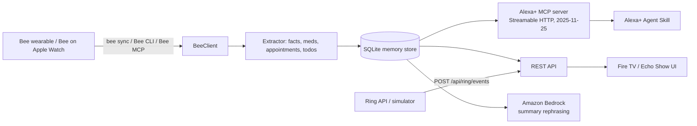

# 🐝 BeeBridge — A Memory Companion for Seniors

**Build, Ship, Shape: Amazon Developer Hackathon** · Primary track: **Bee** · Also built for: **Alexa+**, **Ring** · Mini challenges: **AWS Builder**, **Open Source**

BeeBridge turns conversations captured by a **Bee wearable** (or Bee on Apple Watch) into a memory a senior can *talk to*:

- Bee captures real conversations — a doctor's instructions, a family call, a pharmacy visit.
- BeeBridge extracts **facts, medication, appointments and to-dos** from Bee's transcripts.
- An **Alexa+ Agent Skill / self-hosted MCP server (spec 2025-11-25, Streamable HTTP)** answers questions conversationally: *"Alexa, what did the doctor say about my next appointment?"*
- **Ring** events add safety context: a package Bee heard was coming actually arrives → Alexa announces it and the to-do completes itself. A doorbell press becomes a caregiver-style alert.
- A large-text **Fire TV / Echo Show web UI** shows today's summary at a glance.
- **Amazon Bedrock** (AWS Builder) rephrases summaries in short, clear sentences when AWS is configured.

> Bee was designed to "remember the moments that matter." BeeBridge makes that memory *proactive and voice-first* for the people who need it most.

## Quick start (2 minutes, no hardware)

```bash
python -m venv .venv && source .venv/bin/activate
pip install -r requirements.txt -r requirements-dev.txt
PYTHONPATH=src python -m beebridge.demo      # scripted end-to-end demo
PYTHONPATH=src uvicorn beebridge.main:app --app-dir src --port 8000
#   Fire TV UI:  http://localhost:8000/tv
#   Health:      http://localhost:8000/health
#   MCP (Alexa+): POST http://localhost:8000/mcp
pytest                                        # 8 tests
```

The repo bundles realistic **Bee sync exports** in `data/bee_sample/` so the full pipeline runs without a device. With a real Bee, the *same code path* ingests your data — see "Using a real Bee" below.

## Architecture



## How each hackathon requirement is met — in code

| Requirement | Where |
|---|---|
| **Bee**: project actually uses Bee data via CLI/MCP | `src/beebridge/bee/client.py` (`bee sync`, `bee today`, export ingestion), `src/beebridge/bee/mcp_client.py` (Bee MCP client), entry point `service.sync_from_bee()` runs on startup |
| **Alexa+**: self-hosted MCP server, spec ≥ 2025-11-25, Streamable HTTP | `src/beebridge/alexa/mcp_server.py` (`POST /mcp`, protocolVersion `2025-11-25`, tools `beebridge_ask/today/todos/sync_bee/ring_simulate`) + `alexa-skill/agent-skill.yaml` + classic skill package in `alexa-skill/skill-package/` and Lambda in `src/beebridge/alexa/lambda_handler.py` |
| **Ring**: app works through Ring simulator / API events | `src/beebridge/ring/simulator.py`, webhook `POST /api/ring/events` (doorbell, motion, person, package delivery) |
| **AWS Builder**: AWS services with documented integration | Amazon Bedrock Converse in `src/beebridge/aws/bedrock.py`; deployable SAM template (Lambda + API Gateway + DynamoDB + Bedrock IAM) in `infra/aws/template.yaml` |
| **Open Source** | MIT `LICENSE`; this repo is the open-source project (see `SUBMISSION.md` for the mini-challenge fields) |
| **Fire TV** | `web/index.html` large-text daily summary, served at `/tv`, runs in the Fire TV / Vega browser |

## Using a real Bee

1. Enable Bee Developer Mode and install the Bee CLI so `bee` is on your PATH.
2. Run `bee sync` once (BeeBridge also calls it for you via `BeeClient.sync()`).
3. Either let BeeBridge read the sync exports:
   ```bash
   export BEE_EXPORT_DIR=/path/to/your/bee/exports
   ```
   or point BeeBridge at Bee's MCP server:
   ```bash
   export BEE_MCP_URL=https://your-bee-mcp-endpoint
   ```
4. Start BeeBridge. Your real conversations are ingested by the exact pipeline the sample data exercises.

**Privacy:** Bee records only with the user's consent and its hardware switch stays in the user's control; BeeBridge stores memory locally (SQLite) by default, never shares it with caregivers unless the user enables that, and deletes nothing on the Bee itself.

## Ask it things

```bash
curl -s localhost:8000/api/ask -H 'Content-Type: application/json' \
  -d '{"question":"What did the doctor say about my next appointment?"}'
curl -s localhost:8000/api/ask -H 'Content-Type: application/json' \
  -d '{"question":"What medication do I need to take?"}'
curl -s localhost:8000/api/ring/events -H 'Content-Type: application/json' \
  -d '{"kind":"package_delivery","device_name":"Front Door"}'
```

## Demo video script

See `docs/demo-script.md` — a timed, under-3-minutes script that leads with the doctor-recall moment.

## Product feedback & friction log

Required by the hackathon and genuinely useful: `docs/product-feedback.md`, `docs/friction-log.md`.

## Layout

```
src/beebridge/bee/     Bee CLI + Bee MCP client (Bee track tech, executed)
src/beebridge/alexa/   MCP server for Alexa+ (2025-11-25) + Lambda skill handler
src/beebridge/ring/    Ring event model + simulator matching logic
src/beebridge/aws/     Amazon Bedrock summarizer (AWS Builder)
src/beebridge/core/    models, SQLite store, extractor, Q&A service
web/                   Fire TV / Echo Show UI
alexa-skill/           Agent Skill definition + classic skill package
infra/aws/             SAM template (Lambda/API GW/DynamoDB/Bedrock)
data/bee_sample/       bundled Bee sync exports for hardware-free demos
tests/                 pytest suite (8 tests)
```

## License

MIT — see `LICENSE`.
